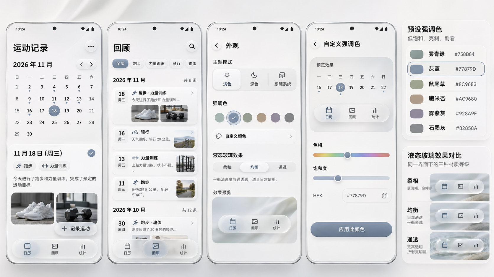
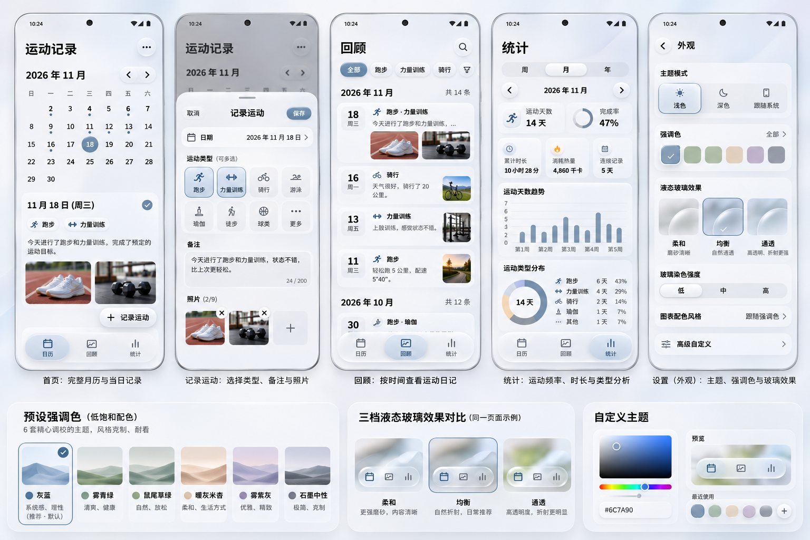

# Actiary — V2 低饱和主题与 Liquid Glass 设计规范

> 版本：V2.0 · 2026-11-19  
> 平台：Android / Kotlin / Jetpack Compose  
> 核心定位：以完整月历为入口的轻量运动日记  
> 本文目的：供设计评审与 AI 编程实现使用。所有示意图属于概念效果图，非像素级最终 UI。





## 1. 已确定的产品约束

1. **首页方案 A**：顶部完整月历，下面是所选日期的运动内容；不可默认折叠成周历。
2. 主要页面：日历、回顾、统计，设置通过导航栏外的入口进入。
3. 数据层仍按日期组织：`DailyRecord`、`ExerciseEntry`、`ExerciseType`、`PhotoAttachment`；允许一天多个运动类型、备注、照片和后补记录。
4. 每天状态为：已锻炼、休息日、未记录，**未记录不等于休息日**。
5. 视觉目标：iOS 原生秩序感 + 自定义 Liquid Glass 材质，**不是**全屏泛玻璃或 MD3 默认组件视觉。
6. 先优化浅色界面，保留深色与跟随系统的能力；默认强调色为灰蓝，默认玻璃等级「均衡」、玻璃染色「低」。
7. 离线优先，不因主题系统引入账号、云端配置或网络依赖。

## 2. 视觉原则

- **中性底色主导**：页面背景、正文、列表和照片不受强调色大面积染色；少量强调色用于交互与数据高亮。
- **玻璃只用于浮动控制层**：底部导航栏、浮动记录按钮、月份切换、菜单、Sheet 的局部控件；日历格、长文本、图片容器采用清晰的实色或弱底色。
- **少量视觉层级**：避免重复说明文字、层层卡片、过度边框、夸张高光。
- **语义不依赖色相**：打卡、休息、未记录状态使用形状/图标/文案共同表达；夜间与色觉差异下仍可辨认。
- **外观设置独立于业务数据**：更换主题、玻璃等级和深浅色不能改变已保存的日期、运动类型、图片或统计结果。

### 2.1 中性色基础（建议初值，后续真机校准）

| Token | Light | Dark | 用途 |
|---|---|---|---|
| `background` | `#F8F8F6` | `#141619` | 全屏背景 |
| `surface` | `#FFFFFF` | `#1E2125` | 日记条目和编辑输入底面 |
| `surfaceMuted` | `#F0F1F0` | `#282C31` | 弱区分底色 |
| `textPrimary` | `#22262A` | `#F1F2F2` | 标题和正文 |
| `textSecondary` | `#6B737B` | `#ADB4BC` | 辅助信息 |
| `divider` | `#DEE1E2` | `#383D43` | 轻量分隔 |
| `glassNeutralTint` | `#FFFFFF` | `#333941` | 玻璃底色，不等于不透明底色 |

建议遵循“中性色占大多数、强调色少量点缀”的原则；80/15/5 是设计检查方法，不是需要在代码中计算的面积比例。

## 3. 六套低饱和强调色

| Preset ID | 名称 | Seed HEX | 调性 |
|---|---|---|---|
| `mist_teal` | 雾青绿 | `#758B84` | 清爽、平静 |
| `slate_blue` | 灰蓝 | `#77879D` | 冷静、系统感，**默认** |
| `sage` | 鼠尾草 | `#8C9683` | 自然、放松 |
| `sand` | 暖米杏 | `#AC9680` | 温暖、生活方式 |
| `dusty_lavender` | 雾紫灰 | `#928A9F` | 细腻、克制 |
| `graphite` | 石墨灰 | `#82858A` | 几乎无彩色、极简 |

> 以上 Seed 是视觉基色，并不直接担任“白字按钮底色”。六色在白字上的对比度大约为 2.8–3.7:1，不足以让普通小字号白字都满足 4.5:1；使用时必须生成深色交互派生色，或采用深色字。

### 3.1 强调色语义 Token

- `accentSeed`：用户选择或输入的原始种子颜色，需原样保存。
- `accentAction`：经过亮度/饱和度调整后，确保与 `onAccentAction` 可读的按钮/选中背景。
- `onAccentAction`：放在 `accentAction` 上的文字与图标颜色，按对比度选择白/深色。
- `accentSubtle`：混合 90%–96% 中性表面后的浅选中色，不用于正文文本。
- `accentStroke`：边框/选中线，保证相邻表面有清楚分界。
- `accentChart`：统计主系列颜色，必要时略加深。
- `glassAccentTint`：只占玻璃染色的少量比重，不等同完整 Seed 涂层。

**实现规则**：先将自定义 Seed 转为 HCT/OKLCH 一类感知色彩空间生成派生色；对交互强调色按对比度校正，再映射到 Compose `Color`。若使用 Material Color Utilities，**只复用色彩计算，不直接套用整套 Material You 视觉规范**。参考：<https://github.com/material-foundation/material-color-utilities>。

- 正文、按钮小字号文本及重要数字：目标文本对比度至少 **4.5:1**。
- 必须辨认的主要图形、图标、边框：目标非文本对比度至少 **3:1**。
- 装饰性折射高光不要求满足上述阈值，但不能承担唯一状态信息。
- 用户选择非常亮或高饱和的自定义 Seed 时，**保留其输入值**，自动调整实际 UI 派生色，并在预览中真实显示结果；不静默修改用户输入的 HEX。

## 4. 设置页面信息架构

### 设置 > 外观

1. **主题模式**：浅色 / 深色 / 跟随系统。默认浅色（如需更贴近 Android 习惯，后续可改默认跟随系统；二者不影响数据结构）。
2. **强调色**：六个预设色块，可立即生效；进入“自定义颜色”做高级设置。
3. **液态玻璃效果**：柔和 / 均衡 / 通透。默认均衡。
4. **玻璃染色强度**：低 / 中 / 高。默认低；此项控制颜色参与程度，不覆盖玻璃等级的折射参数。
5. **效果预览**：同一背景上展示小型日历选中态、主按钮和浮动底栏。背景要有少量可辨别内容，方便判断真实折射。
6. **统计图表配色**（可放二级设置）：跟随强调色 / 中性优先 / 低饱和分类色；初版默认“中性优先”。
7. **恢复默认外观**：仅重置外观，不触及运动历史和照片。

### 4.1 预设选择交互

- 点击色块：直接设置当前预设，底栏、日历选中和按钮立刻更新；DataStore 异步持久化。
- 选中色块通过描边、勾选图标、可读文字共同体现；不能只靠颜色差异。
- 选择其他预设不会删除上一次保存的自定义颜色。
- 深浅模式切换会重新生成同一 Seed 的适配色阶，而非直接把 Light 色值搬到 Dark。

### 4.2 自定义颜色页面

- 页面顶部：小日历 + 浮动底栏 + 主按钮的真实预览区。
- 中部：二维颜色区域（色相/明度或饱和度的直观选择），下面提供色相、饱和度调节。
- 底部：支持 `#RRGGBB` HEX 输入、最近使用颜色（例如最近 5 个）、“应用此颜色”主按钮。
- 打开页面时将已生效颜色复制到 **draft 状态**；拖动或输入只修改预览；按“应用此颜色”才写入 `customAccentHex` 并切换 accent 模式为 `custom`。
- 用户返回而未应用：丢弃本次草稿，不意外污染全局外观。
- 解析错误/无效 HEX：保留草稿并提示错误，禁止应用；不接受透明 Alpha 使底栏失去可读性。
- 可提供“恢复到当前应用色”操作；无需复杂历史版本管理。

## 5. 三档玻璃效果与染色强度

### 5.1 效果等级（按相对强度解释，不是 Backdrop 原生参数名）

| 设计参数 | 柔和 Soft | 均衡 Balanced（默认） | 通透 Clear |
|---|---:|---:|---:|
| 背景模糊强度 | 0.80 | 0.55 | 0.30 |
| 边缘折射强度 | 0.20 | 0.55 | 0.85 |
| 边缘高光强度 | 0.30 | 0.55 | 0.72 |
| 色散强度 | 0.00 | 0.12 | 0.28 |
| 背景透过感 | 0.25 | 0.55 | 0.82 |
| 厚度/局部放大感 | 0.15 | 0.40 | 0.68 |

以上归一化数字仅用于 UX 目标和调参表，需在实际 Backdrop Shader/Effect API 中通过实验映射。不要将它们原封不动当成库方法参数。

**特别说明**：通透不等于无限降低背景遮罩；过低模糊叠加真实照片背景时容易影响图标识别，必要时动态提升内部对比层强度。柔和也不等于纯白半透明按钮，至少应保留轻微高光、厚度和背景采样。

### 5.2 玻璃染色强度

以独立 `GlassTintStrength` 控制，建议初始 *视觉调节范围*：

- `LOW`：强调色在玻璃材质中的附加混色约 2%–4%。
- `MEDIUM`：约 5%–8%。
- `HIGH`：约 9%–12%。

这是用于试验的材质混色权重，不是最终不透明度或 Backdrop 原生 API 值。应先和中性玻璃底材混合，再执行视觉可读性检查。

### 5.3 哪些控件使用玻璃

| 控件 | 玻璃 | 备注 |
|---|---|---|
| 浮动底部导航 | 是，主要表现区 | 流动选中胶囊、自然折射、边缘高光 |
| 悬浮记录按钮 | 是 | 选中态与按压反馈共享配置 |
| 月份左右切换 | 是，较弱 | 尺寸小，不应用强烈色散 |
| 更多菜单及浮层 | 是 | 保持文字对比度 |
| 记录 Sheet | 局部 | Sheet 主表面应清晰，顶部与交互控件可玻璃化 |
| 月历日期格 | 否 | 使用实心选中圆、圆点与短横线，避免 42 个 Shader |
| 运动日记列表 | 否 | 中性实色表面，尽量减少嵌套 |
| 备注输入与照片 | 否 | 内容层禁止无意义的厚玻璃叠加 |
| 数据统计图 | 否 | 可读的实线、柱形和数值 |

### 5.4 背景采样条件

- 浮动底栏背后的真实内容（日期详情、图片等）滚动经过时，可直观观察折射；不要用单纯灰白背景模拟“全程有玻璃”。
- 不要对同一底栏组件叠加多个独立玻璃渲染引擎；使用共享的 backdrop 采样范围。
- 通透等级需要有最低可读遮罩；在背景图片纹理复杂、设备节能或系统减少动画时允许安全降级。

## 6. 页面实施细节

### 6.1 日历首页（保留方案 A）

**顶部**：大标题“运动记录”；右上独立玻璃菜单按钮。月份行可以通过小玻璃胶囊切换上/下月。完整月历始终占据顶部主视觉。

**日期状态**：
- 已锻炼：日期下方小圆点；当天选中时，选中圆底使用交互强调色，圆点切换高对比色。
- 休息日：日期下方短横线或小休息符号，必要时详情写明“休息日”。
- 未记录：普通日期，无标记；不等同未完成运动。
- 今天但未选中：轻量边框；已选中：实心圆底 + 明确文字。

**日期详情**：日期标题 / 一组运动类型标签 / 可选备注摘要 / 图片预览 / “记录运动”浮动按钮。无记录时显示简单空状态和按钮，不保留大块空白占位。照片使用实际图片，不加彩色滤镜。

### 6.2 运动记录编辑 Sheet

- Sheet 自下进入；日期可选、支持历史补记。
- 常用运动类别图标网格；支持多选。选中态使用 `accentSubtle` + 描边/勾选，而非纯高饱和色块。
- 运动详情可按需展开时长/距离等可选字段；不强迫填写。
- 单条日期备注文本框；支持多张照片、缩略图、移除、查看大图。
- 保存按钮固定在内容底部的安全区域，输入键盘弹出时避免遮挡；退出未保存修改可提示。
- “快速打卡”无需填写运动类型；“休息日”不能误删除原有照片。

### 6.3 回顾

- 按月分组，时间线或低密度卡片展示日期、运动类型、备注片段与照片。
- 筛选控件使用清晰的 iOS 风格胶囊，不让每一项都执行完整 Shader。
- 标题、照片和备注保持中性；强调色主要用于筛选选中及焦点。

### 6.4 统计

- 周 / 月 / 年分段选择器；运动天数、各类型出现次数、时长（有数据才显示）。
- 柱状图可以单一低饱和强调色；非重点区使用低对比度辅助色。
- 类别分布需要使用可区分的低饱和分组色及文字图例，不能只用同一色亮度导致无法区分。
- 不要为不存在的运动时长、卡路里数据做推算；缺少数据展示“暂无记录”。

### 6.5 设置

- 视觉保持 iOS 分组列表的节奏：外观、数据、关于。
- 外观页先显示主题模式，再显示六个强调色色块；下面是玻璃等级与染色强度及预览。
- “高级自定义”作为从外观页进入的二级页面，不在设置首页铺开大量调参滑块。
- 预览与实际使用同一个 `ThemeTokens` 和玻璃实现，防止预览与主界面效果不同。

## 7. 技术架构与开源复用

### 7.1 技术选型

- Kotlin + Jetpack Compose：原生界面与状态更新。
- [`Kyant0/AndroidLiquidGlass`](https://github.com/Kyant0/AndroidLiquidGlass) / Backdrop：玻璃背景采样与光学效果。参考它的官方示例，封装项目级材质组件；不要在项目中混装多个玻璃引擎。
- [`kizitonwose/Calendar`](https://github.com/kizitonwose/Calendar)：完整月历，自定义日期单元格。
- [`material-color-utilities`](https://github.com/material-foundation/material-color-utilities)：可选的 HCT 色阶生成与对比度计算依据；仅作为算法库。
- Room：运动数据、日期、照片索引，不存放外观配置。
- DataStore：外观配置持久化。
- Coil 3：照片显示与缩略图缓存。

> 库版本按实际开工时已验证的兼容版本锁定。Backdrop 当前接口可能随发布版本变化，避免在规划中虚构具体 API/参数名。

### 7.2 主题模型（伪 Kotlin，旨在定义契约）

```kotlin
enum class ThemeMode { LIGHT, DARK, SYSTEM }
enum class AccentPreset { MIST_TEAL, SLATE_BLUE, SAGE, SAND, DUSTY_LAVENDER, GRAPHITE, CUSTOM }
enum class GlassLevel { SOFT, BALANCED, CLEAR }
enum class GlassTintStrength { LOW, MEDIUM, HIGH }
enum class ChartPalette { NEUTRAL_FIRST, FOLLOW_ACCENT, MUTED_CATEGORIES }

data class AppearanceSettings(
    val themeMode: ThemeMode = ThemeMode.LIGHT,
    val accentPreset: AccentPreset = AccentPreset.SLATE_BLUE,
    val customAccentHex: String = "#77879D",
    val glassLevel: GlassLevel = GlassLevel.BALANCED,
    val glassTintStrength: GlassTintStrength = GlassTintStrength.LOW,
    val chartPalette: ChartPalette = ChartPalette.NEUTRAL_FIRST,
)
```

实现 `AppearanceRepository` 将 DataStore 流转换为 `AppearanceSettings`；`ThemeResolver` 将 `(settings, resolvedDarkMode)` 转换为 `ThemeTokens`；最外层 `AppTheme` 提供 CompositionLocal/显式 tokens 给页面；所有玻璃组件由一个 `GlassRenderer` 适配层接入 Backdrop。

```text
DataStore -> AppearanceRepository -> AppearanceSettings
                                    | 
                                    v
                     ThemeResolver(dark/light, seed)
                                    |
                                    v
                    ThemeTokens + GlassProfile
                                    |
                  +-----------------+----------------+
                  |                 |                |
            Calendar UI       Glass controls     Charts UI
```

- 预设选择：更新 `accentPreset`，不覆盖 `customAccentHex`。
- 自定义页面：独立 `customDraftHex`，仅“应用”时持久化。
- 切换深浅模式：不重启 Activity，Compose 响应状态重组；过渡时间短且遵循系统动画设置。
- 备份：作为 App 的完整备份时可以包含设置；导入旧数据缺少设置字段则应用默认值。

### 7.3 内部玻璃组件接口（项目定义，不是第三方库现成 API）

```kotlin
@Composable fun GlassBottomBar(selectedTab: Tab, onSelect: (Tab) -> Unit)
@Composable fun GlassIconButton(onClick: () -> Unit, content: @Composable () -> Unit)
@Composable fun GlassFloatingAction(text: String, onClick: () -> Unit)
@Composable fun GlassSegmentedPicker(options: List<String>, selected: Int, onSelect: (Int) -> Unit)
@Composable fun GlassPreview(profile: GlassProfile, accent: ThemeTokens)
```

组件不在内部读取 DataStore；仅接收已解析的 tokens/profile，以便设置页预览草稿和主页面共享实现。

## 8. 光学效果与性能边界

1. 不对日历每个单元格单独使用实时玻璃 Shader；只让浮动层采样内容。
2. 背景采样应限定范围，并在页面滚动、动画完成后避免无意义重算。
3. 对不支持完整效果的 Android/API/GPU 组合，提供半透明中性面 + 细边缘高光的简化版本；功能不应受影响。
4. 避免把玻璃透明度、染色、模糊三者混为一个参数；每个等级提供稳定的光学语义。
5. 深色模式重点检查文字、图标、日历标记与照片上的悬浮底栏是否可读。
6. 支持系统“减少动画”或动画缩放设置；长按流动等高级动画可简化为短时位置过渡。

## 9. 开发顺序与验收

### Phase A：主题基础
- [ ] 6 种预设与中性 Light/Dark tokens
- [ ] DataStore 外观字段与默认值
- [ ] 单一种子色的派生色生成、自动对比度校正
- [ ] 设置页预设切换、主题模式切换

**验收**：从任意预设切换到另一个，所有可见页面颜色同步更新；重启后仍保持；正文可读；照片不被染色。

### Phase B：玻璃组件
- [ ] `GlassBottomBar`、玻璃图标按钮、浮动记录按钮
- [ ] 柔和/均衡/通透及低/中/高染色的配置映射
- [ ] 复杂背景下的可读性遮罩与降级材质
- [ ] 配置切换实时预览

**验收**：三档效果能明显区分边缘折射、模糊及通透感；文字和图标始终可辨；切换不改变控件位置。

### Phase C：全页面替换
- [ ] 首页日历/当日详情/记录 Sheet
- [ ] 回顾/统计页面的低饱和颜色策略
- [ ] 自定义颜色编辑器与草稿应用行为
- [ ] Light/Dark/系统模式检查

**验收**：六套预设均可用于所有页面；各页面没有遗留高饱和彩色卡片；未记录与休息日不混淆。

### Phase D：收尾
- [ ] 完整备份包含外观设置，旧数据默认兼容
- [ ] 真机测试页面滚动与液态玻璃性能
- [ ] 检查自定义高饱和/过亮颜色、深色模式、无照片/多照片等典型边界

## 10. 尚待最终确认的细节（建议默认）

1. 默认主题为浅色（当前推荐）；支持跟随系统但不必成为默认。
2. 默认强调色灰蓝 `#77879D`。
3. 默认玻璃「均衡」、染色「低」。
4. 图表默认“中性优先”，分类图适当使用其他低饱和色且配套文字图例。
5. 自定义色仅要求一个 HEX/颜色选择值，不开放多色逐项编辑，以保持简洁。
6. 运动类型图标默认中性线框，当前选中使用强调色；暂不为每一运动类型默认分配浓重固定颜色。

---

## 11. 参考资料

- Backdrop / AndroidLiquidGlass：<https://github.com/Kyant0/AndroidLiquidGlass>
- Calendar Compose：<https://github.com/kizitonwose/Calendar>
- Material Color Utilities：<https://github.com/material-foundation/material-color-utilities>
- Compose 动态配色背景资料：<https://developer.android.com/develop/ui/compose/designsystems/material3>

**说明**：Material Color Utilities 可用于颜色计算，不代表本项目将使用 Material Design 3 的默认组件样式。图片中的文字、数值、照片均为示例数据，数据统计口径应与业务逻辑另行保持一致。
